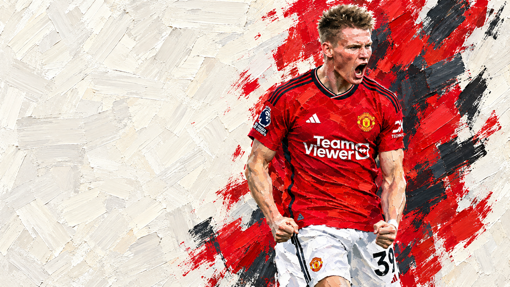

# Football Art Story

**足球球员生涯逐笔绘画动画 Skill · v2.0**

从德布劳内彩色素描与麦克托米奈宽笔厚涂的实际制作流程整理而来。用于横版球员生涯短视频、同人物换画法、已有作品调整，以及独立章节交付。



## 能做什么

- **逐笔绘画**：连续轮廓、分层排线或大面积厚涂，完整画完后默认停留一秒。
- **保持人物**：换画法时保留本人身份、动作、五官位置和身体比例；概括与精画两档，另有独立粗线简笔画。
- **可读排版**：1920×1080横版，左侧大字叙事、右侧人物；生涯数据、关键比赛、奖杯和主要奖项总览。
- **多种画法**：彩铅、石墨、水彩、蜡笔、钢笔、粗线简笔画，以及独立的宽笔厚涂／油漆涂鸦流程。
- **真实资料**：按时期核对发型、球衣、号码、赞助、队徽和奖杯；数据保留口径及核验时间。
- **分章交付**：厚涂流程可生成完整HTML、独立章节HTML、1080p MP4、预览目录及ZIP。

## 在 Codex 中使用

将本仓库保存为本机 Skills 目录下的 `football-art-story` 文件夹，确保其中直接包含 `SKILL.md`。Windows 首次安装可在 PowerShell 中执行：

```powershell
git clone https://github.com/com122/football-art-story.git "$env:USERPROFILE\.codex\skills\football-art-story"
```

如果目标目录已经存在，先备份旧版，再按你的本地管理方式更新。随后可直接提出：

> 使用 $football-art-story，为这位球员做生涯绘画动画。采用大面积厚涂，保持参考照片动作，白色中混少量球队颜色，正文清晰，最后按章节交付。

也可以指定“德布劳内同款彩色素描”“保留动作改为钢笔”“只修改已有作品”“只导出独立章节”。完整入口见 [SKILL.md](SKILL.md)。

## 两条制作流程

| 流程 | 格式与入口 |
|---|---|
| 彩铅／线描与多媒介工作台 | `schemaVersion: 1`；[参数](references/art-controls.md)、[数据格式](references/profile-format.md) |
| 大面积厚涂／油漆涂鸦 | `schemaVersion: football-gouache/1`；[制作流程](references/gouache-workflow.md)、[数据格式](references/gouache-format.md) |

两种格式使用各自的引擎。新球员需要本人的时期照片、对应画稿和已核实资料；示例中的人物、装备和数据只属于示例球员。

## 直接运行厚涂示例

在仓库目录中执行，Node建议22或更新版本：

```text
node scripts/build-gouache.mjs assets/gouache-demo/story.json outputs/demo.html
```

此步骤只使用Node内置模块。生成的HTML内嵌笔触数据，可独立播放和重画，无需携带源图片。

更多流程：

- [从画稿提取笔触](references/gouache-workflow.md)：需要Python的numpy、Pillow和OpenCV。
- [动画与画法检查](references/quality-checks.md)：厚涂帧检查使用 `@napi-rs/canvas`，通过参数传入已有依赖目录。
- [逐章MP4与ZIP](references/chapter-delivery.md)：需要FFmpeg，默认1080p、30fps、H.264、无音轨。
- [修改与迭代](references/production-flow.md)：保留当前选择、处理最新更正、管理淘汰稿和验证范围。
- [其他Agent复用](references/agent-handoff.md)：按实际工具能力交接和验证。

## v2.0 验证

已检查原素描示例、新版四章厚涂示例、完整绘画与一秒停留、跨章重播、独立HTML、MP4时长和帧数、ZIP打包及含空格的路径。画稿身份与美术效果仍需按新项目实际查看。

本仓库包含Skill指引、脚本、排版参考、画法示例和可运行的冻结演示数据。
